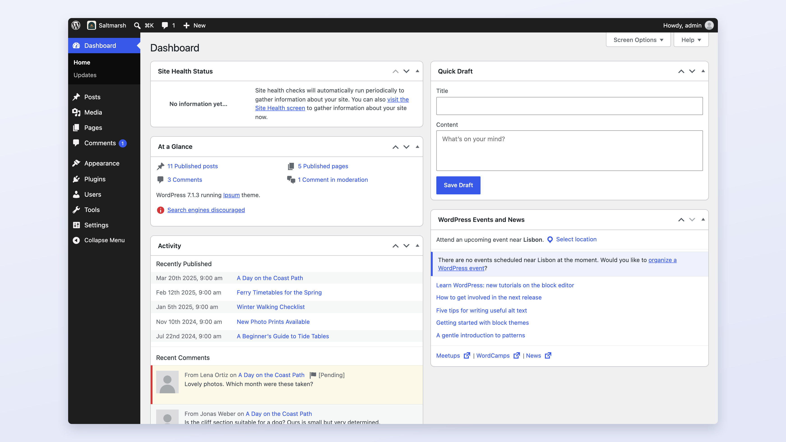
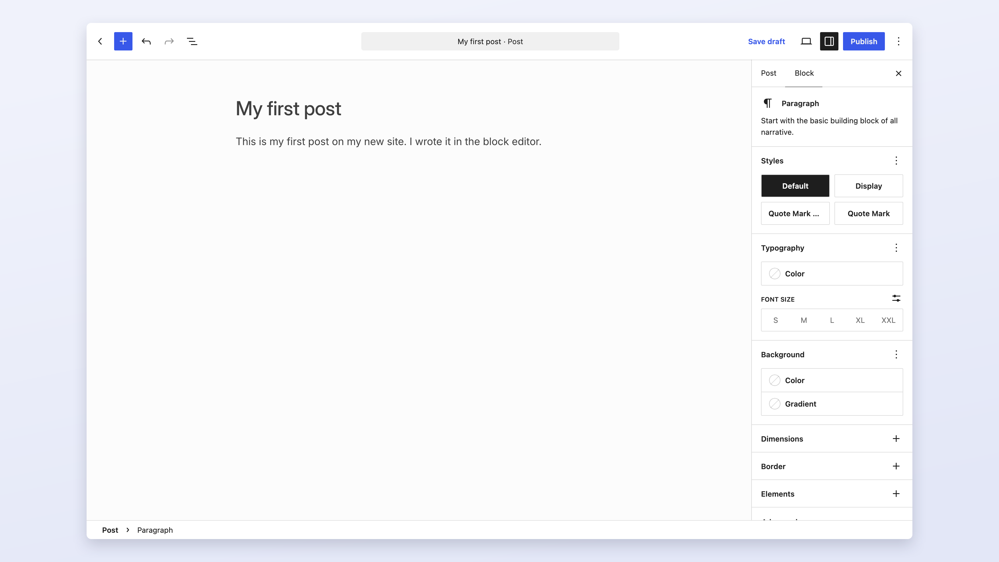
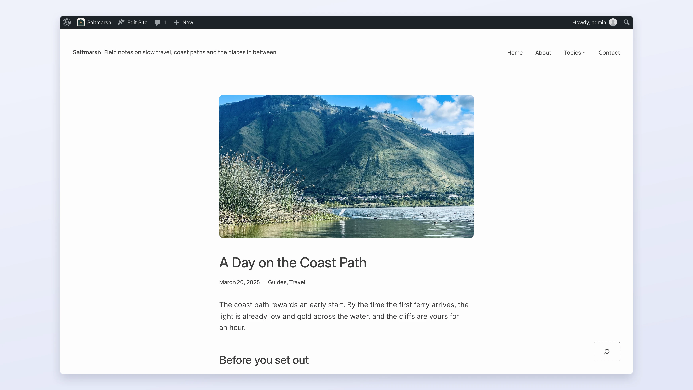

# Your first site: a guided tour

In this tutorial you take a new WordPress site from a fresh install to a site with a name, a first post and a front page of your choice. Along the way you learn the dashboard, the toolbar, the editor and the difference between what you see as an administrator and what a visitor sees. It takes about 30 minutes.

You need a WordPress site and the username and password of its administrator account. If you do not have a site yet, see [Install WordPress](install-wordpress.md), or open [WordPress Playground](https://playground.wordpress.net/) to follow along in your browser. Feel free to click around as you go: nothing in this tutorial is hard to undo.

## Log in

Go to your site's address followed by `/wp-admin/`, for example `https://example.com/wp-admin/`. WordPress shows the login form. Enter your username (or email address) and password, and select **Log In**.

> [!TIP]
> Bookmark the login page. Some themes also show a login link on the site itself, but the `/wp-admin/` address always works.

## Find your way around the dashboard

After you log in, you land on the **Dashboard**. This is the administration area of your site, sometimes called the back end or wp-admin. Visitors never see it.

The dashboard has three parts.

**The admin menu**, down the left side, leads to every part of the administration area:

- **Posts**: blog posts, plus their categories and tags.
- **Media**: images, videos, audio and documents you upload.
- **Pages**: pages such as About and Contact.
- **Comments**: comments from visitors, to approve, answer or delete.
- **Appearance**: themes, and the Site Editor where you design the site.
- **Plugins**: features you add to WordPress.
- **Users**: the people who can log in to the site, and what each of them is allowed to do.
- **Tools**: import, export and site health.
- **Settings**: the site title, the date format, the front page, comments, links and more.

Point at an item to see its submenu, or select it to open it.

**The main area** shows boxes called widgets. On a new site, a **Welcome to WordPress!** panel at the top offers shortcuts; you can dismiss it. **At a Glance** counts your posts, pages and comments. **Activity** lists recent posts and comments. **Quick Draft** saves an idea as a draft post. **Site Health Status** tells you whether WordPress has found problems with the site's setup. **WordPress Events and News** lists meetups near you and news from WordPress.org. Use **Screen Options** at the top right to show or hide them.

**The toolbar** runs across the top of every screen while you are logged in, both in the dashboard and on the site itself.

## Learn the toolbar

From left to right, the toolbar has:

- **The WordPress logo**, with links to WordPress.org, the documentation and support.
- **Your site's name.** In the dashboard, it takes you to the site as visitors see it (**Visit Site**). On the site, it takes you back to the **Dashboard**.
- **A search button** labeled <kbd>Ctrl</kbd> + <kbd>K</kbd> (<kbd>⌘</kbd> + <kbd>K</kbd> on a Mac), in the dashboard only. It opens the command palette, where you type the name of a screen or an action to go straight to it.
- **Comments**, with the number waiting for your approval.
- **New**, a shortcut to create a post, a media item, a page or a user.
- On the right, **Howdy** and your name, with **Edit Profile** and **Log Out**.

On the site itself, the toolbar also shows links to edit what you are looking at, such as **Edit Site** when your theme is a block theme.

## Look at your site as a visitor

Select your site's name in the toolbar. This is the front end of your site: what visitors see. A new site uses the current default theme and already has a sample post called "Hello world!" and a page called "Sample Page".

Look at the parts of the page. The header at the top holds the site title and the navigation. The middle shows your content: on a new site, a list of your latest posts. The footer at the bottom closes the page. The theme decides all of this layout. You will change the content first, and the design later.

Go back to the dashboard: select your site's name in the toolbar again, then **Dashboard**.

## Write and publish your first post

1. In the admin menu, go to **Posts > Add Post**. The editor opens.
2. Select **Add title** and type a title for your post.
3. Press <kbd>Enter</kbd> and type a first paragraph. Every paragraph you type is a block. Press <kbd>Enter</kbd> again to start a new paragraph.

   

4. Select **Publish** at the top right. WordPress opens a panel that asks **Are you ready to publish?** and shows the post's visibility and publish date.
5. Select **Publish** again in that panel. WordPress confirms that the post is live.
6. Select **View Post** to see it on your site.

This is your post's own page, as visitors see it. The post also appears at the top of the list of latest posts.

To learn the editor properly, with headings, images, categories and a featured image, follow [Create a post](../write/create-a-post.md).

### Remove the sample content

You do not need "Hello world!" or "Sample Page". Go to **Posts > All Posts**, point at "Hello world!" and select **Trash**. Do the same for "Sample Page" under **Pages > All Pages**. Trashed items stay in the trash for 30 days, so you can restore them if you change your mind.

## Name your site

A new site has the title you chose during installation, and a short tagline. Change them now, because themes show them in the header, browsers show the title in tabs, and search engines show it in results.

1. Go to **Settings > General**.
2. In **Site Title**, enter your site's name.
3. In **Tagline**, describe the site in a few words, or leave it empty.
4. Select **Save Changes** at the bottom of the screen.

Visit the site to see the new title in the header. The other settings on this screen, such as **Timezone** and **Date Format**, are worth a look too: set the timezone to yours so scheduled posts go out at the right time. [General settings](../manage/settings/general.md) explains each one.

## Choose a theme

The theme decides how your whole site looks. A new site uses the default theme, which works well for many sites, but you can choose another one at any time without losing content.

1. Go to **Appearance > Themes**. Your active theme comes first.
2. Select **Add Theme** to browse the free themes in the WordPress.org theme directory. The **Block Themes** tab lists themes you can edit with the Site Editor.
3. Point at a theme and select **Preview** to look at it, or **Install** and then **Activate** to switch your site to it. Themes you have already installed have a **Live Preview** button on the **Themes** screen that shows them with your own content.

To change colors, fonts and layouts, and to edit the header and footer, go to **Appearance > Editor**. [Design your site](../design/README.md) shows how, and [Themes](../design/themes/README.md) explains how to choose and install one.

## Add a page and choose your front page

Posts are for content that is dated and appears in a list, such as news or articles. Pages are for content that stays put, such as About or Contact. By default your front page shows your latest posts. Many sites prefer a fixed page as their front page instead.

1. Go to **Pages > Add Page**, give the page a title such as "Home", add some text, and select **Publish** twice.
2. Create a second page called "Blog" and publish it. Leave it empty: WordPress fills it with your posts.
3. Go to **Settings > Reading**.
4. Under **Your homepage displays**, select **A static page**.
5. Set **Homepage** to "Home" and **Posts page** to "Blog".
6. Select **Save Changes**.

Visit your site. The front page now shows your Home page, and your posts are on the Blog page. [Set a static front page](../write/organize/static-front-page.md) covers the details, and [Create a page](../write/create-a-page.md) explains pages.

## What you did

You logged in, learned the dashboard and the toolbar, published a post and viewed it as a visitor, named your site, saw where themes are chosen, and set a page as your front page. That is the core loop of WordPress: you work in the dashboard and the editor, and the theme presents your content to visitors.

## Next steps

- Understand how all the parts fit together: [How a WordPress site is put together](how-wordpress-works.md).
- Write with images, headings and categories: [Create a post](../write/create-a-post.md).
- Design your site with the Site Editor: [Design your site](../design/README.md).
- Invite other people to help: [Users and roles](../manage/users/README.md).
- Keep your site safe from the start: [Security](../manage/security/README.md).
- Learn the words you will meet: [Glossary](glossary.md).
