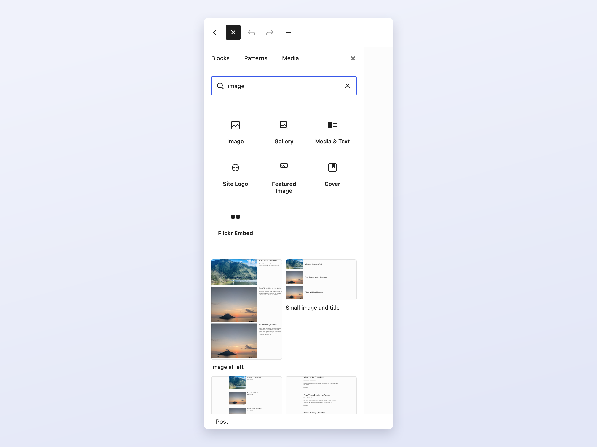
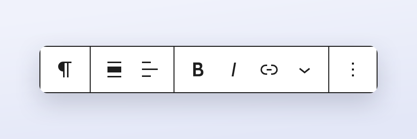
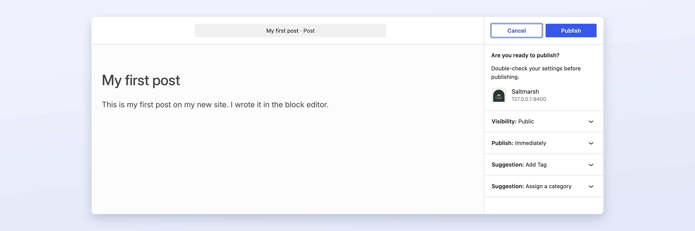

# Create a post

In this tutorial you write a complete post in the block editor and publish it. You add text, a heading and an image, set a category and a featured image, preview the post, and publish it. Along the way you learn the parts of the editor you will use every day. It takes about 15 minutes.

You need to be logged in to a WordPress site with a role that can publish posts (Author, Editor or Administrator). Have an image on your computer ready to upload.

## Open the editor

In the admin menu, go to **Posts > Add Post**. You can also use **New > Post** in the toolbar at the top of the screen.

The editor opens with an empty post.

The editor has three areas:

- **The editor toolbar** along the top. On the left are the **Block Inserter** (the `+` button), **Undo**, **Redo** and **Document Overview**. On the right are **Save draft**, **View** (previews), **Settings**, **Publish** and **Options**.
- **The canvas** in the middle, where you write. It looks close to how the post will look on your site.
- **The settings sidebar** on the right, with two tabs: **Post**, for settings that apply to the whole post, and **Block**, for the block you have selected. Select **Settings** (the icon at the top right) to open or close it.

## Write a title and your first paragraphs

1. Select **Add title** and type a title for your post.
2. Press <kbd>Enter</kbd>. The cursor moves to a new, empty block that says **Type / to choose a block**.
3. Type your first paragraph. Everything you type here goes into a Paragraph block.
4. Press <kbd>Enter</kbd> to end the paragraph. WordPress creates a new Paragraph block for the next one.

Write two or three short paragraphs. WordPress saves a draft for you automatically every few seconds, and you can select **Save draft** at any time.

## Add a heading with the slash shortcut

Headings break a post into sections that readers can scan.

1. On a new empty line, type `/heading`. A list of matching blocks appears as you type.
2. Press <kbd>Enter</kbd> to choose **Heading**. The empty line becomes a Heading block.
3. Type the heading text.
4. Press <kbd>Enter</kbd> and continue writing below it in a new paragraph.

The `/` shortcut works for every block: type `/` followed by part of the block's name, such as `/list`, `/quote` or `/image`.

## Add an image with the inserter

The **Block Inserter** shows every block you can add, grouped and searchable.

1. Select the paragraph after which you want the image.
2. Select the **Block Inserter** (`+`) at the top left of the editor. A panel opens with the **Blocks**, **Patterns** and **Media** tabs.

   

3. Type `image` in the search field and select **Image**. An Image block appears in the post.
4. In the Image block, select **Upload** and choose the image on your computer. You can also choose **Media Library** to use an image you uploaded before, or **Insert from URL**.
5. With the image selected, open the **Block** tab of the settings sidebar and fill in **Alternative text**: a short description of what the image shows, for people who cannot see it.

To add a caption, select the image and type below it, or use the caption button in the block toolbar. [Media](media/README.md) explains uploading and managing files.

## Use the block toolbar

Select any block and a toolbar appears above it. This is the block toolbar.

From left to right it usually has:

- **The block type**, which also lets you transform the block into another one, such as a paragraph into a heading or a list.
- Controls to change the block's position: drag the block by its handle, or use the **Move up** and **Move down** arrows. Depending on the block and the screen size, they appear next to the block type or when you point at it.
- **Controls for this kind of block**: alignment for a paragraph, heading level for a heading, crop and link for an image, and formatting such as **Bold**, **Italic** and **Link** for text.
- **Options** (the three dots), with copy, duplicate, insert before or after, and delete.

Each kind of block has its own toolbar and its own settings in the **Block** tab of the sidebar, such as color, typography and spacing. [Working with blocks](blocks/README.md) explains them in detail, and [The editor](editor/README.md) covers the rest of the editor.

## Choose a category and a featured image

Select the **Post** tab in the settings sidebar. It holds the settings for the whole post.

**Featured image.** At the top of the **Post** tab, select **Set featured image** and choose or upload an image. Most themes show the featured image at the top of the post and next to it in lists of posts and search results.

**Categories.** Open the **Categories** panel. Select one or more categories that describe the post. To make a new one, select **Add Category**, type its name and confirm. Every post has at least one category; if you choose none, WordPress uses the default category, **Uncategorized**. [Categories](organize/categories.md) explains how to plan them.

The **Post** tab also has the post's **Status**, **Publish** date, **Slug**, **Author**, **Template** and **Discussion** settings, a link to add an excerpt, and the **Tags** panel. You can leave them as they are for now.

## Preview the post

Before you publish, see the post as visitors will.

1. Select **View** in the editor toolbar.
2. Choose **Desktop**, **Tablet** or **Mobile** to see the post at that size inside the editor, or **Preview in new tab** to open it with your theme in a new browser tab.

Go back to the editor tab to keep editing. A preview is visible only to you.

## Publish

1. Select **Publish** at the top right of the editor.
2. A panel slides in and asks **Are you ready to publish?** Check the settings it shows, or select **Cancel** to go back to editing:
   - **Visibility**: **Public** means anyone can read the post.
   - **Publish**: **Immediately** publishes now. Select it to choose a future date and time to schedule the post instead.
   - **Suggestion** rows, for example to add tags or assign a category if you have not.

   

3. Select **Publish** in the panel.

The panel confirms that your post **is now live** and shows its address, with a button to copy it.

## What happens after you publish

- Your post is on your site. Select **View Post** in the panel to see it.
- It appears at the top of your blog page and in your site's feed, and in the archive of each category you chose.
- If your site sends notifications or shares posts through a plugin, that happens now.
- You can keep editing. The **Publish** button is now **Save**: changes go live when you select it. WordPress keeps a revision each time you save, so you can go back to an earlier version.
- To take the post down, open the **Post** tab, select its status, and change it to **Draft**. To delete it, choose **Move to trash** at the bottom of the **Post** tab.

To start another post, select **Add Post** in the panel.

## Next steps

- Learn the statuses, scheduling and visibility options: [Publish](publish/README.md).
- Learn every way to add, move and style blocks: [Working with blocks](blocks/README.md).
- Get to know the editor's other tools: [The editor](editor/README.md).
- Manage your images and files: [Media](media/README.md).
- Plan the categories for your site: [Categories](organize/categories.md).
